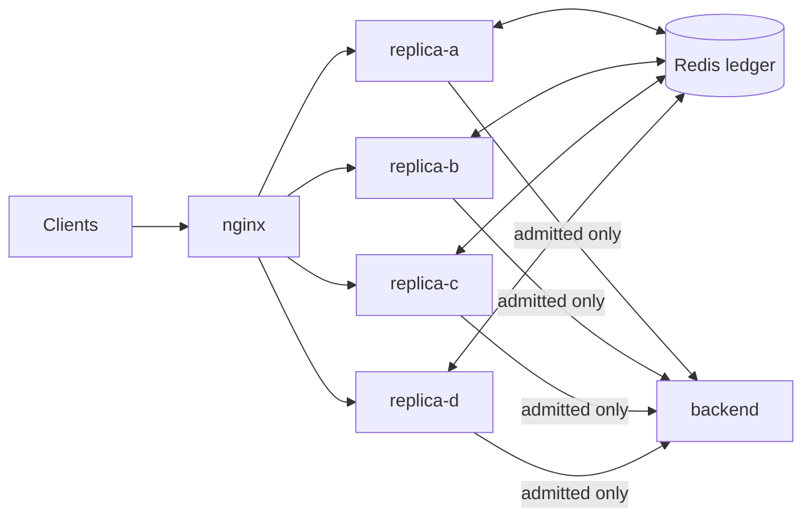

# Distributed Admission-Controlled RPC Gateway

A credit-based admission-control gateway that runs as several replicas
behind a load balancer while enforcing **one** global capacity budget,
using Redis Lua scripts for atomic coordination. Inspired by Breakwater
(OSDI '20).

## Problem

A single gateway can track outstanding credits in memory. Run N replicas
for availability and each one tracks its own budget, so together they
admit up to **N×** the intended capacity. The same failure appears in any
horizontally scaled component that enforces a global limit: rate
limiters, inventory counts, seat reservations.

## Approach

All state that has to be exact lives in Redis and is changed atomically:

- **Reserving credits** is one Lua script that purges expired
  reservations, compares outstanding credits with the shared budget, and
  reserves only what fits.
- **Consuming a credit** is `SET NX` on the credit's nonce, so exactly one
  replica can accept a given credit.
- **The budget** adapts to measured queueing delay (EWMA + AIMD) inside a
  second Lua script, so replicas share one control loop.

Credits are HMAC-signed, expire after 30 s, and are single-use. Clients
that present forged or replayed credits accumulate suspicion and are
throttled, then blocked.



Details: [docs/architecture.md](docs/architecture.md) ·
[docs/consistency-guarantees.md](docs/consistency-guarantees.md)

## Results

From `scripts/benchmark_report.py` (4 replica processes, 1 backend,
Redis 7 on the same host; 2-vCPU Xeon @ 2.1 GHz). Single run; rerun it to
get numbers for your machine.

| Measurement | Result |
|---|---|
| Credits issued, 4 replicas, budget 10, **isolated** | 41 (4.1× over-admission) |
| Credits issued, 4 replicas, budget 10, **coordinated** | 10 |
| 20 concurrent reservation attempts, budget 10 | 10 issued, 0 over budget |
| 10 credits each spent twice concurrently | 10 accepted, 10 rejected as replays |
| Coordination cost per reservation (p50) | +0.08 ms with local Redis; earlier runs on a laptop measured +1.5 ms |
| Bad-signature attempts before a client is blocked | 3 |
| Backend work, `complexity` 2 → 80 | 1.3 ms → 50 ms |

The trade-off: coordination adds one Redis round trip per reservation and
removes the N× over-admission.

**Failure behavior:** if Redis is unreachable, replicas return 5xx for
both credit issuance and RPC calls, so nothing is admitted (fail closed).
What is and is not guaranteed, including the AOF durability window, is in
[docs/consistency-guarantees.md](docs/consistency-guarantees.md).

## Run it

### Docker Compose (nginx + 4 replicas + backend + Redis with AOF)

```bash
docker compose up --build
curl localhost:8000/dashboard   # via nginx
curl localhost:9001/dashboard   # replica-a directly
curl localhost:9002/dashboard   # replica-b: same shared_budget as replica-a
curl localhost:7000/stats       # backend request count
```

### Locally

```bash
redis-server --daemonize yes
pip install -r requirements-dev.txt

pytest tests -v                          # ledger, HTTP admission, concurrency, Redis-down
python3 scripts/multi_replica_demo.py    # isolated vs. coordinated over-admission
python3 scripts/end_to_end_demo.py       # cross-replica spend and replay rejection
python3 scripts/benchmark_report.py      # all measurements above (~90 s)
```

## Predictive capacity planning (offline)

`capacity_planning/` simulates a day of traffic with a recurring midday
peak (M/M/1 approximation) and compares four budget strategies. It is a
simulation study and is not wired into the live gateway.

| Strategy | Mean delay | p99 delay | Overload ticks | Rejected |
|---|---|---|---|---|
| Fixed budget | 6.9 ms | 11.6 ms | 0 | 9.5% |
| Reactive (live control law) | 11.5 ms | 69.2 ms | 108 | 3.4% |
| Predictive (seasonal forecast) | 18.1 ms | 133.8 ms | 249 | 0.9% |
| Hybrid (forecast + reactive correction) | 11.4 ms | 44.4 ms | 99 | 2.4% |

Prediction alone rejects the least traffic but overloads more, because it
cannot correct a wrong forecast. Hybrid gives the best p99 and fewest
overload ticks. For an unforecastable spike, all strategies fall back to
reactive behavior.

```bash
python3 capacity_planning/simulate.py
```

## Repository layout

```
server/              gateway replica (FastAPI)
shared/              credit format, Redis ledger, in-memory ledger
backend/             protected service
nginx/               load balancer config
capacity_planning/   offline budget-strategy simulation
scripts/             demos and benchmark report
tests/               pytest suite
docs/                architecture and consistency guarantees
```

## Reference

Cho, I., Saeed, A., Fried, J., Park, S. J., Alizadeh, M., & Belay, A.
(2020). *Overload Control for μs-scale RPCs with Breakwater*. OSDI '20.
