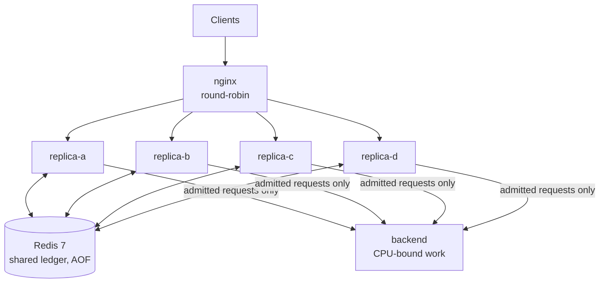
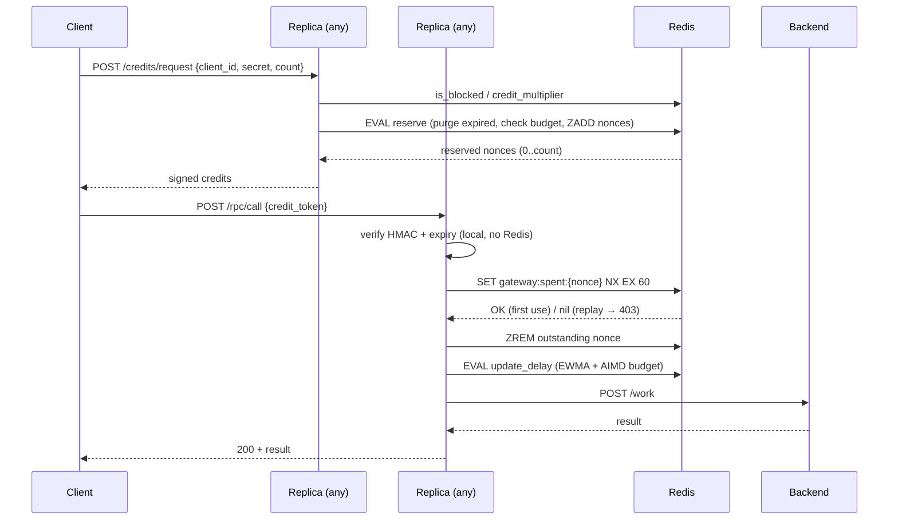

# Architecture

## Components

| Component | Code | Role |
|---|---|---|
| nginx | `nginx/nginx.conf` | Single entrypoint; round-robins across four replicas. |
| Gateway replica | `server/main.py` | Authenticates clients, issues signed credits, verifies and consumes credits, forwards admitted calls to the backend. Stateless apart from local metrics. |
| Shared ledger | `shared/ledger.py` | All cross-replica state in Redis, mutated through Lua scripts and `SET NX`. |
| Local ledger | `shared/local_ledger.py` | Same interface, in-process state. Used only for `COORDINATION_MODE=isolated`, to reproduce the over-admission bug. |
| Credit format | `shared/credit.py` | HMAC-SHA256-signed token carrying `client_id`, `nonce`, `issued_at`, `expires_at`. |
| Backend | `backend/service.py` | The protected service. Work cost scales with `complexity` (SHA-256 rounds), capped at 5 concurrent jobs. |
| Capacity planning | `capacity_planning/` | Offline simulation comparing fixed, reactive, predictive and hybrid budget strategies. Not wired into the live gateway. |

## Request flow

## Redis keys

| Key | Type | Contents |
|---|---|---|
| `gateway:outstanding` | sorted set | Reserved-but-unspent nonces, scored by expiry time. Its cardinality is what the budget is compared against. |
| `gateway:budget` | string | Current shared budget (1–10). |
| `gateway:ewma_delay_ms` | string | Shared EWMA of queueing delay across replicas. |
| `gateway:spent:{nonce}` | string, TTL 60 s | Marker that a credit has been consumed. |
| `gateway:trust:{client_id}` | hash | `suspicion`, `violations`, `last_update`. |

## Budget control law

Every admitted request reports its queueing delay. A Lua script updates the
shared EWMA (`alpha = 0.3`) and then adjusts the budget AIMD-style: above
the 20 ms target the budget is multiplied by 0.7 (floor 1); at or below it,
the budget grows by 2 (ceiling 10). Because the update runs inside Redis,
all replicas converge on one budget instead of each adapting independently.

## Client trust

Each failed credit check adds a penalty to the client's suspicion score
(bad signature 0.40, replay 0.35, malformed 0.30, expired 0.05). Suspicion
decays at 0.01 per second and drops by 0.02 for each good request. At 0.8
the client is refused new credits; below that, the number of credits it is
granted scales with `1 - suspicion`.

## Coordination modes

`COORDINATION_MODE=coordinated` (default) uses the Redis ledger.
`COORDINATION_MODE=isolated` gives each replica its own in-memory ledger;
with four replicas this issues about 4× the intended budget, which is what
`scripts/multi_replica_demo.py` measures.

See [consistency-guarantees.md](consistency-guarantees.md) for exactly what
is and is not guaranteed.
